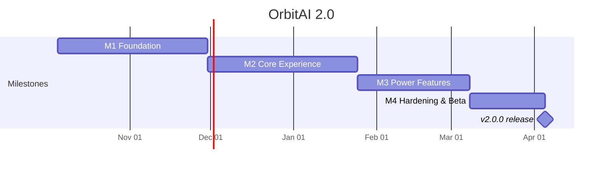

# OrbitAI 2.0 Roadmap

**Target release:** v2.0.0, week of **5 April 2027** (current: v1.1.3, released 2026-04-23)
**Planning window:** 5 Oct 2026 → 4 Apr 2027 (26 weeks)
**Status:** Draft for owner review · Issues: 59 new (`f003`–`f061`) + 4 existing (#39–#42)

---

## Progress

Completed items are marked ✅ in the tables below (🟡 = code done, still needs a device run or owner check); each issue file ends with a **Status** line describing what was done. Unchecked boxes in a completed issue are items that need a device or an owner decision (noted in its Status line).

### Status of existing GitHub issues

- **#39 🟡 (2026-10-03):** `OrbitBubbleService` (1,828 lines) split into `BubbleOverlayUi` (result card, radial menu, markdown, clipboard, themes: 598 lines), `BubbleSpeechController` (SpeechRecognizer lifecycle: 132), `BubbleInferenceController` (LlmRepository, inference jobs, tools, screen capture, MediaProjection continuation: 656) and `OrbitBubbleService` (lifecycle, bubble view, snapping, animations, notification: 612). Code was moved verbatim with only reference rewiring; public companion API unchanged. Builds, unit tests and lint pass; the app launches on device without crashes. **Open:** the service is 612 lines, not ≤ 500 (the bubble view's drag/snap/animation code is ~250 lines and #39 keeps it in the service; a 5th `BubbleFloatingView` file would fix this if wanted). Manual test of tap → speech → overlay → radial menu still needed (the bubble is disabled on the test phone).

---

## 1. Goal

> **From "a private chat app" to "the on-device assistant people use every day."**

1.x proved the hard part: local LLMs (LiteRT-LM, ONNX GenAI, MediaPipe) plus Gemini, RAG Spaces, Modes, Memory, a floating bubble, and real device actions (calls, reminders, drafts). 2.0 makes that foundation **fast, trustworthy and reachable from anywhere on the phone**.

| # | Outcome | How we'll know |
|---|---|---|
| 1 | **Fast and stable on real phones** | No full model reload after Stop; turn-10 time-to-first-token ≈ turn-1; downloads survive app close; crash-free sessions ≥ 99% in beta |
| 2 | **Answers you can trust** | Context never overflows; Spaces answers show citations; memory holds only facts the user confirmed |
| 3 | **Everywhere on the phone** | Widgets, Quick Settings tile, shortcuts, share-to-Orbit, text-selection actions, voice mode |
| 4 | **Does more, safely** | One tool registry with native tool calling; 8+ new device tools, all behind confirmation cards |
| 5 | **Private by design, verifiably** | Backup/restore, privacy center, temporary chats |

---

## 2. What the code audit found

Each item was confirmed by reading the current `dev` branch, not assumed. Each is tracked as an issue.

| Finding | Where | Impact | Issue |
|---|---|---|---|
| Entire chat history + all memories + 5 RAG chunks go into every prompt, never trimmed | `ChatViewModel.sendMessageForChat` | Long chats overflow small models → errors or garbage | [f011](issues/f011-context-window-budget.md) |
| Every streamed token writes to Room, which re-queries **all chats with all messages** | `ChatRepository.updateMessage` + `observeAllChatsWithMessages` | Lower tokens/sec, UI jank, battery drain | [f012](issues/f012-batch-streaming-writes.md) [f013](issues/f013-lightweight-chat-queries.md) |
| Stop / interrupting a reply **closes the engine**, forcing a full model reload | `ChatViewModel.stopGeneration` | Several seconds' wait after every Stop | [f014](issues/f014-stop-without-unload.md) |
| Gemini gets a Gemma-formatted string (`<start_of_turn>…`) as one user message, with no `systemInstruction` | `geminiChatModelOrNull` (defaults to `PromptStyle.GEMMA`) + `GeminiApiEngine` | Worse cloud answers; mode prompts weakened | [f015](issues/f015-gemini-native-multiturn.md) |
| Model downloads run in `viewModelScope`; the partial file is deleted on any failure; no checksum | `DownloadViewModel`, `ModelDownloader` | A 4 GB download restarts from 0 after a network blip | [f018](issues/f018-resumable-background-downloads.md) |
| Bubble keeps its own `LlmRepository` alive while the app loads a second one | `OrbitBubbleService.bubbleLlmRepo` (closed only in `onDestroy`) | Two multi-GB models in RAM → low-memory kills | [f007](issues/f007-shared-app-container.md) |
| Regex auto-memory saves junk ("I am a bit confused" → *User is a bit confused*) | `ChatViewModel.extractMemoryFacts` | Polluted memory injected into every prompt | [f037](issues/f037-memory-suggestions.md) [f038](issues/f038-relevant-memories.md) |
| Embedder reloaded from disk on **every** query; brute-force scan of all chunk BLOBs | `SpaceRepository.searchChunksInSpaces` | Slow RAG; worse with larger Spaces | [f032](issues/f032-faster-hybrid-retrieval.md) |
| Document ingest errors swallowed; scanned PDFs "succeed" with 0 chunks | `SpaceRepository.processDocument` / `extractPdfPages` | Silent failures in Spaces | [f034](issues/f034-background-ingestion.md) |
| DB at **v13** with 12 untested hand-written migrations, `exportSchema = false` | `AppDatabase` | Highest data-loss risk in a schema-heavy release | [f005](issues/f005-room-schema-migration-tests.md) |
| CI never runs unit tests or lint | `.github/workflows/build-release.yml` | Regressions merge silently | [f004](issues/f004-ci-tests-lint.md) |
| `minSdk = 35` (Android 15+ only) | `app/build.gradle.kts` | Most of the addressable install base excluded | [f003](issues/f003-decide-minsdk.md) |
| 0 `stringResource` calls, 100+ hardcoded UI strings | `ui/screens/*` | App can't be translated | [f050](issues/f050-localization.md) |
| `runBlocking` on the main thread to create a chat | `ChatViewModel.createNewChat` | ANR risk | [f006](issues/f006-remove-runblocking.md) |
| R8 disabled for release | `app/build.gradle.kts` | Larger install, no obfuscation | [f009](issues/f009-enable-r8.md) |
| `allowBackup=false` and no export → new phone = all data lost | `AndroidManifest.xml` | Users lose chats, memories, Spaces | [f055](issues/f055-backup-restore.md) |

---

## 3. Timeline



| Milestone | Dates | Theme | Exit criteria |
|---|---|---|---|
| **M1 Foundation** | 5 Oct → 29 Nov 2026 | Fix what's broken, make change safe | CI runs tests; migrations tested; context budget, streaming writes, Gemini and downloads fixed; one model in RAM |
| **M2 Core Experience** | 30 Nov 2026 → 24 Jan 2027 | Make daily chat great | Message actions, markdown, voice mode, search/organise, better RAG + memory, localisation framework |
| **M3 Power Features** | 25 Jan → 7 Mar 2027 | Assistant everywhere, doing more | Tool registry + new tools, text actions, widgets/tiles, backup |
| **M4 Hardening & Beta** | 8 Mar → 4 Apr 2027 | Feature freeze → ship | R8 on, accessibility pass, closed beta ≥ 2 weeks, upgrade-tested, zero open P0 |

### Scope rules
Counts below are for the 56 new issues.
- **P0 (9):** must ship; the release slips before these are cut.
- **P1 (31):** committed scope.
- **P2 (19):** stretch, cut first, in this order: M3 P2 → M4 P2 → M2 P2. Anything cut moves to a `2.1` milestone, not deleted.
- **Feature freeze:** 8 March 2027. After that, only bug fixes and the M4 items.

---

## 4. Milestone plans

### M1 Foundation · 5 Oct → 29 Nov 2026
Fix the confirmed bugs and put in the safety net (CI, migration tests, diagnostics) before adding features. #39 and f007 untangle the bubble and the app before both get new work.

| ID | Item | Pri | Size | Depends on |
|---|---|:-:|:-:|---|
| [f003](issues/f003-decide-minsdk.md) | ✅ Decide the minimum Android version for 2.0 (currently Android 15+ only) | P0 | S |  |
| [f004](issues/f004-ci-tests-lint.md) | ✅ Run unit tests and Android lint in CI on every PR | P0 | S |  |
| [f005](issues/f005-room-schema-migration-tests.md) | ✅ Export the Room schema and add migration tests | P0 | M |  |
| [f006](issues/f006-remove-runblocking.md) | ✅ Remove `runBlocking` from `createNewChat` (main-thread database I/O) | P1 | S |  |
| [#39](https://github.com/rudra273/orbitAI/issues/39) | 🟡 Split OrbitBubbleService into focused components *(existing)* | P1 | L |  |
| [f007](issues/f007-shared-app-container.md) | 🟡 Share one `LlmRepository` and repository set across the app and the bubble | P1 | L | #39 |
| [f008](issues/f008-split-chatviewmodel.md) | 🟡 Split `ChatViewModel` (1,034 lines) into focused controllers | P1 | L | f007 |
| [f010](issues/f010-crash-diagnostics.md) | ✅ Privacy-respecting crash and ANR diagnostics | P1 | M |  |
| [f011](issues/f011-context-window-budget.md) | 🟡 Fit prompts to the model's context window | P0 | M |  |
| [f012](issues/f012-batch-streaming-writes.md) | 🟡 Stop writing to the database on every streamed token | P0 | M |  |
| [f015](issues/f015-gemini-native-multiturn.md) | ✅ Send Gemini real multi-turn content and system instructions (not Gemma-formatted text) | P0 | M |  |
| [f018](issues/f018-resumable-background-downloads.md) | 🟡 Resumable background model downloads with integrity checks | P0 | L |  |

**Suggested order:** f004 → f005 → f003 (decision) → f011 / f012 / f015 (independent, parallelisable) → f018 → #39 → f007 → f008. f006 and f010 fill gaps.

### M2 Core Experience · 30 Nov 2026 → 24 Jan 2027
Make the main chat feel modern and the knowledge features trustworthy.

| ID | Item | Pri | Size | Depends on |
|---|---|:-:|:-:|---|
| [f013](issues/f013-lightweight-chat-queries.md) | ✅ Load chat summaries for the list and one chat's messages for the detail screen | P1 | M |  |
| [f014](issues/f014-stop-without-unload.md) | 🟡 Stopping a reply shouldn't unload the model | P1 | M | f008 |
| [f016](issues/f016-litertlm-conversation-reuse.md) | 🟡 Reuse LiteRT-LM conversations across turns in the main chat | P1 | L | f011, f014 |
| [f017](issues/f017-device-aware-models.md) | ✅ Device-aware model recommendations and a RAM guard | P1 | M |  |
| [#40](https://github.com/rudra273/orbitAI/issues/40) | 🟡 NPU → GPU → CPU cascading backend fallback *(existing)* | P1 | S |  |
| [#41](https://github.com/rudra273/orbitAI/issues/41) | 🟡 GPU support for MediaPipeTaskEngine (legacy models) *(existing)* | P2 | S |  |
| [#42](https://github.com/rudra273/orbitAI/issues/42) | 🟡 Show active backend in bubble overlay *(existing)* | P2 | S | #40 |
| [f019](issues/f019-generation-stats.md) | 🟡 Show generation stats in chat (time-to-first-token, tokens/sec, backend) | P2 | S |  |
| [f022](issues/f022-message-actions.md) | ✅ Message actions: copy, regenerate, edit & resend, delete, share | P0 | M | f008 |
| [f023](issues/f023-full-markdown-rendering.md) | 🟡 Complete markdown rendering: tables, links, quotes, numbered lists, syntax highlighting | P1 | M |  |
| [f024](issues/f024-read-aloud-voice-mode.md) | 🟡 Read replies aloud and a hands-free voice conversation mode | P1 | L |  |
| [f025](issues/f025-organize-and-search-chats.md) | 🟡 Pin, rename and archive chats, plus full-text search across all messages | P1 | L | f005, f013 |
| [f026](issues/f026-export-chat.md) | 🟡 Export and share a conversation | P1 | M |  |
| [f027](issues/f027-temporary-chats.md) | 🟡 Temporary (incognito) chats | P1 | S |  |
| [f028](issues/f028-command-palette-saved-prompts.md) | ✅ Command palette and saved prompts ("/" menu) | P1 | M |  |
| [f029](issues/f029-camera-capture.md) | 🟡 Take a photo directly from chat for vision models | P2 | S |  |
| [f030](issues/f030-ai-chat-titles.md) | 🟡 Generate short chat titles with the model | P2 | S |  |
| [f032](issues/f032-faster-hybrid-retrieval.md) | 🟡 Faster and better retrieval: cached embedder, in-memory index, hybrid search | P1 | M |  |
| [f034](issues/f034-background-ingestion.md) | 🟡 Reliable background document ingestion with progress and error reasons | P1 | M |  |
| [f036](issues/f036-share-files-to-orbit.md) | 🟡 Share files and images to Orbit from any app | P1 | M |  |
| [f037](issues/f037-memory-suggestions.md) | 🟡 Replace noisy regex memory extraction with "Remember this?" suggestions | P1 | M |  |
| [f038](issues/f038-relevant-memories.md) | 🟡 Inject only relevant memories, and let users edit them | P1 | M | f011, f032 |
| [f050](issues/f050-localization.md) | Move UI strings to resources and ship the first translations | P1 | L |  |
| [f051](issues/f051-theme-and-text-size.md) | 🟡 Theme options: follow system, dynamic colour, pure black, chat text size | P2 | M |  |

### M3 Power Features · 25 Jan → 7 Mar 2027
Orbit becomes an assistant: it acts through tools and is reachable from anywhere on the phone. f040 is the largest single item; start it in the first week.

| ID | Item | Pri | Size | Depends on |
|---|---|:-:|:-:|---|
| [f020](issues/f020-model-catalog-refresh.md) | Refresh the model catalog for 2.0 (Qwen and newer small models) | P2 | M | 🟡 |
| [f021](issues/f021-import-custom-model.md) | Import a custom local model file | P2 | M | 🟡 |
| [f031](issues/f031-upgrade-embedding-model.md) | Upgrade the on-device embedding model and re-index Spaces | P1 | L |  |
| [f033](issues/f033-rag-citations.md) | 🟡 Show sources: citations from Spaces in answers | P1 | M | f032 |
| [f035](issues/f035-more-knowledge-sources.md) | More knowledge sources: DOCX, EPUB, web pages, and in-app notes | P2 | L | f034 |
| [f039](issues/f039-modes-2.md) | 🟡 Modes 2.0: per-mode model and Spaces, templates gallery, import/export | P2 | M |  |
| [f040](issues/f040-unified-tool-registry.md) | Unified tool registry with native tool calling | P1 | XL | f008, f016 |
| [f041](issues/f041-new-device-tools.md) | 🟡 New device tools: timers, alarms, SMS, navigation, open app, web search, calendar events | P1 | L | f040 |
| [f042](issues/f042-text-selection-actions.md) | 🟡 Text actions in the selection menu: summarize, translate, rewrite, proofread | P1 | M |  |
| [f044](issues/f044-notification-digest.md) | Daily notification digest (opt-in, on-device) | P2 | L |  |
| [f045](issues/f045-reminders-plus.md) | 🟡 Reminders+: monthly and weekday repeats, custom snooze, reminder from any message | P2 | M |  |
| [f046](issues/f046-home-screen-widgets.md) | Home-screen widgets: Ask Orbit, voice, upcoming reminders | P1 | L |  |
| [f047](issues/f047-qs-tile-and-shortcuts.md) | 🟡 Quick Settings tile and launcher shortcuts | P1 | S |  |
| [f048](issues/f048-assistant-app-spike.md) | Spike: make Orbit selectable as the device's digital assistant | P2 | M | 🟡 |
| [f049](issues/f049-bubble-followups.md) | 🟡 Bubble: follow-up questions and "Continue in app" | P2 | M | #39, f007 |
| [f055](issues/f055-backup-restore.md) | 🟡 Backup and restore all OrbitAI data | P1 | L | f005 |

### M4 Hardening & Beta · 8 Mar → 4 Apr 2027
Feature freeze. Polish, performance, accessibility, then a staged beta.

| ID | Item | Pri | Size | Depends on |
|---|---|:-:|:-:|---|
| [f009](issues/f009-enable-r8.md) | Enable R8 code and resource shrinking for release builds | P1 | M |  |
| [f052](issues/f052-accessibility-ui-tests.md) | Accessibility pass and Compose UI tests for core flows | P1 | M |  |
| [f053](issues/f053-adaptive-layouts.md) | Adaptive layouts for tablets, foldables and landscape | P2 | M |  |
| [f054](issues/f054-onboarding-whats-new.md) | Onboarding 2.0 and a "What's new in 2.0" screen | P2 | M | f017, f018 |
| [f057](issues/f057-privacy-center.md) | 🟡 Privacy center: what's stored, what left the device, one-tap clearing | P2 | M |  |
| [f059](issues/f059-docs-refresh.md) | Documentation refresh for 2.0 | P2 | S | 🟡 |
| [f060](issues/f060-baseline-profile.md) | Baseline profile and startup benchmarks | P2 | M |  |
| [f061](issues/f061-release-hardening.md) | 2.0 release hardening: beta track, device matrix, release checklist | P0 | M |  |

---

## 5. Epics (cross-cutting view)

| Epic | Issues |
|---|---|
| **Engine & performance** | [f011](issues/f011-context-window-budget.md), [f012](issues/f012-batch-streaming-writes.md), [f013](issues/f013-lightweight-chat-queries.md), [f014](issues/f014-stop-without-unload.md), [f015](issues/f015-gemini-native-multiturn.md), [f016](issues/f016-litertlm-conversation-reuse.md), [f019](issues/f019-generation-stats.md), [f060](issues/f060-baseline-profile.md), #40, #41, #42 |
| **Models & downloads** | [f017](issues/f017-device-aware-models.md), [f018](issues/f018-resumable-background-downloads.md), [f020](issues/f020-model-catalog-refresh.md), [f021](issues/f021-import-custom-model.md) |
| **Chat experience** | [f006](issues/f006-remove-runblocking.md), [f022](issues/f022-message-actions.md), [f023](issues/f023-full-markdown-rendering.md), [f024](issues/f024-read-aloud-voice-mode.md), [f025](issues/f025-organize-and-search-chats.md), [f026](issues/f026-export-chat.md), [f027](issues/f027-temporary-chats.md), [f028](issues/f028-command-palette-saved-prompts.md), [f029](issues/f029-camera-capture.md), [f030](issues/f030-ai-chat-titles.md) |
| **Knowledge (Spaces/RAG)** | [f031](issues/f031-upgrade-embedding-model.md), [f032](issues/f032-faster-hybrid-retrieval.md), [f033](issues/f033-rag-citations.md), [f034](issues/f034-background-ingestion.md), [f035](issues/f035-more-knowledge-sources.md), [f036](issues/f036-share-files-to-orbit.md) |
| **Memory & Modes** | [f037](issues/f037-memory-suggestions.md), [f038](issues/f038-relevant-memories.md), [f039](issues/f039-modes-2.md) |
| **Tools & automation** | [f040](issues/f040-unified-tool-registry.md), [f041](issues/f041-new-device-tools.md), [f042](issues/f042-text-selection-actions.md), [f044](issues/f044-notification-digest.md), [f045](issues/f045-reminders-plus.md) |
| **System integration & bubble** | [f046](issues/f046-home-screen-widgets.md), [f047](issues/f047-qs-tile-and-shortcuts.md), [f048](issues/f048-assistant-app-spike.md), [f049](issues/f049-bubble-followups.md), #39 |
| **UI, accessibility, i18n** | [f050](issues/f050-localization.md), [f051](issues/f051-theme-and-text-size.md), [f052](issues/f052-accessibility-ui-tests.md), [f053](issues/f053-adaptive-layouts.md), [f054](issues/f054-onboarding-whats-new.md) |
| **Privacy & data** | [f055](issues/f055-backup-restore.md), [f057](issues/f057-privacy-center.md) |
| **Cloud & connectivity** | [f015](issues/f015-gemini-native-multiturn.md) |
| **Architecture & quality** | [f003](issues/f003-decide-minsdk.md), [f004](issues/f004-ci-tests-lint.md), [f005](issues/f005-room-schema-migration-tests.md), [f007](issues/f007-shared-app-container.md), [f008](issues/f008-split-chatviewmodel.md), [f009](issues/f009-enable-r8.md), [f010](issues/f010-crash-diagnostics.md) |
| **Release** | [f059](issues/f059-docs-refresh.md), [f061](issues/f061-release-hardening.md) |

---

## 6. Decisions needed from the owner

Per project rules, these are not made unilaterally. Each blocks the linked issue; the first three should be settled in M1 week 1.

| # | Decision | Options | Blocks |
|---|---|---|---|
| 1 | Minimum Android version | Keep 35 · lower to 31 · lower to 29/30 | [f003](issues/f003-decide-minsdk.md) (and test matrix in [f061](issues/f061-release-hardening.md)) |
| 2 | Dependency wiring | Manual `AppContainer` (recommended, no new dependency) · Hilt | [f007](issues/f007-shared-app-container.md) |
| 3 | Native tool calling as the primary path | Yes, with regex as fast path/fallback (recommended) · keep regex-only | [f040](issues/f040-unified-tool-registry.md) |
| 6 | New catalog models + URLs | Owner supplies verified repos/revisions | [f020](issues/f020-model-catalog-refresh.md) |
| 7 | First translation locales | e.g. Hindi + one more | [f050](issues/f050-localization.md) |
| 10 | Markdown: library vs in-house parser | Choose by APK size + correctness | [f023](issues/f023-full-markdown-rendering.md) |

---

## 7. Conventions for these issues

- **Numbering** continues the existing scheme (`f001` = #39, `f002` = #40): `f003`–`f061`.
- **Format** matches existing issues: Title · Description · Current/Proposed behavior · Acceptance Criteria checklist.
- **Labels** use only labels that already exist in the repo (`enhancement`, `bug`, `question`, `documentation`, `good first issue`). Milestone, priority, size and area are on the first body line, so labels or milestones can be added later without editing text.
- **Sizes:** S ≤ 2 days · M ≤ 1 week · L 1–3 weeks · XL > 3 weeks.
- **No fabricated URLs:** any issue needing a new endpoint or model URL says the owner provides it.

### Filing the issues on GitHub
Each file in [`issues/`](issues/) is one issue: line 1 is the title, line 2 the labels, the rest is the body. With the GitHub CLI installed and authenticated (`gh auth login`), from the repo root:

```bash
for f in docs/roadmap/issues/f*.md; do gh issue create --repo rudra273/orbitAI --title "$(head -n 1 "$f" | sed 's/^# //')" --label "$(sed -n '2{s/^Labels: //;s/, /,/g;p;}' "$f")" --body "$(tail -n +3 "$f")"; done
```

Optionally create GitHub milestones `2.0 · M1 Foundation` … `2.0 · M4 Hardening & Beta` first and add `--milestone` per file.
